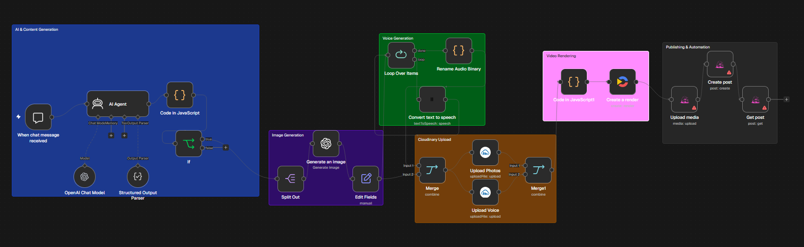

# AI Educational Reels Generator

An AI-powered automation system for generating Arabic educational short-form videos using n8n, AI agents, and multiple API integrations.

I developed this project while preparing for the **CompTIA Security+ (SY0-701) certification** to apply my cybersecurity knowledge through practical AI and automation engineering.

## Key Features

- **Arabic-First Content:** Saudi Arabic narration with English technical terminology.
- **AI Agent:** Structured generation of educational scripts, visuals, quizzes, and captions.
- **Quality Gate:** Programmatic content structure validation before media generation.
- **Sequential API Processing:** Manages API concurrency limitations.
- **Dynamic Audio Synchronization:** Adjusts video timing based on actual voiceover duration.
- **Automated Video Rendering:** Combines generated images, audio, text, and branding.
- **Modular Architecture:** Designed to support future integrations and additional educational subjects.

## System Architecture

## Demo Video

[Watch Demo Video](./demo.mp4)

The demo was produced under budget constraints to validate the technical workflow. Production quality can be further improved through advanced AI models, voice synthesis, visual design, and rendering configurations.

## Technology Stack

| Technology | Purpose |
|---|---|
| n8n | Workflow orchestration |
| OpenAI | AI agents and content generation |
| ElevenLabs | Voice synthesis |
| Cloudinary | Cloud media management |
| Creatomate | Dynamic video rendering |
| Blotato | Planned social media publishing |
| JavaScript | Custom logic and data validation |
| JSON | Structured data processing |

## Implementation Checklist

- [x] AI Agent Development
- [x] Prompt Engineering
- [x] Structured Output Parsing
- [x] Programmatic Quality Validation
- [x] AI Image Generation
- [x] Arabic Voice Generation
- [x] API Concurrency Management
- [x] Binary Data Processing
- [x] Cloud Media Integration
- [x] Dynamic Audio Synchronization
- [x] Automated Video Rendering
- [ ] Blotato Account Configuration
- [ ] Automated Social Media Publishing
- [ ] Content Calendar Integration
- [ ] Scheduled Execution
- [ ] Video Quality Optimization

## Getting Started

1. Download [workflow.json](./workflow.json).
2. Import the workflow into n8n.
3. Install the required integration nodes.
4. Configure your API credentials.
5. Submit an educational topic and execute the workflow.

## Project Status

Working proof of concept with a tested video generation pipeline. Automated publishing and scheduling are planned for future development.

## Disclaimer

This is an independent educational project and is not affiliated with CompTIA.

